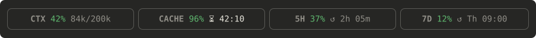

# claude-mods

Mods for [Claude Code](https://claude.com/claude-code): small plugins that change its interface. The repository is a plugin marketplace; each mod lives in `mods/<name>/` and installs on its own.

## session-usage

A band above the prompt with four blocks:



| Block | Shows |
| --- | --- |
| **CTX** | Context window fill: percent and tokens used / window size |
| **CACHE** | Prompt cache hit rate of the last response and an estimated countdown until the cache expires (`❄ cold` once it has; `↻ 84k` when a response had to rewrite the cache) |
| **5H** | Usage of the 5-hour rate-limit window and time left until it resets |
| **7D** | Usage of the weekly rate-limit window and when it resets |

Percentages turn orange at 60% and red at 80%. Toasts warn when the context or the 5-hour window passes 80%, and 5 minutes before the prompt cache expires.

Notes:

- Rate limits appear only on a Claude subscription, and update with each response in the session.
- The cache countdown assumes a 1-hour TTL; Claude Code does not expose the real TTL to mods.
- The mod API is in early access and may change between Claude Code releases.

### Install

At the prompt of a terminal session:

```
/plugin install session-usage --marketplace hoher-roman/claude-mods
```

Answer `y` to add the marketplace, then pick a scope (user scope loads it in every new session).

From a shell:

```bash
claude plugin install session-usage --marketplace hoher-roman/claude-mods
```

In the desktop app: click **+** next to the prompt box, then **Plugins** → **Add marketplace** with `hoher-roman/claude-mods`, then **Add plugin**.

### Run from a local folder

To load the mod from a clone instead, point `CLAUDE_CODE_PLUGIN_DIRS` at its folder in the `env` block of `~/.claude/settings.json`, then start a new session:

```json
{
  "env": {
    "CLAUDE_CODE_PLUGIN_DIRS": "/path/to/claude-mods/mods/session-usage"
  }
}
```

## License

[MIT](LICENSE)
